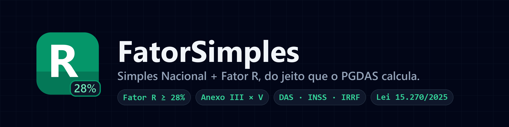
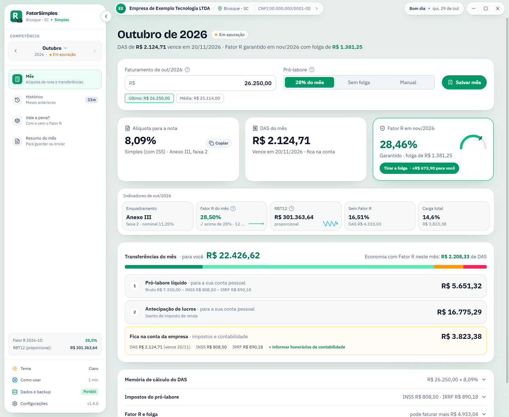
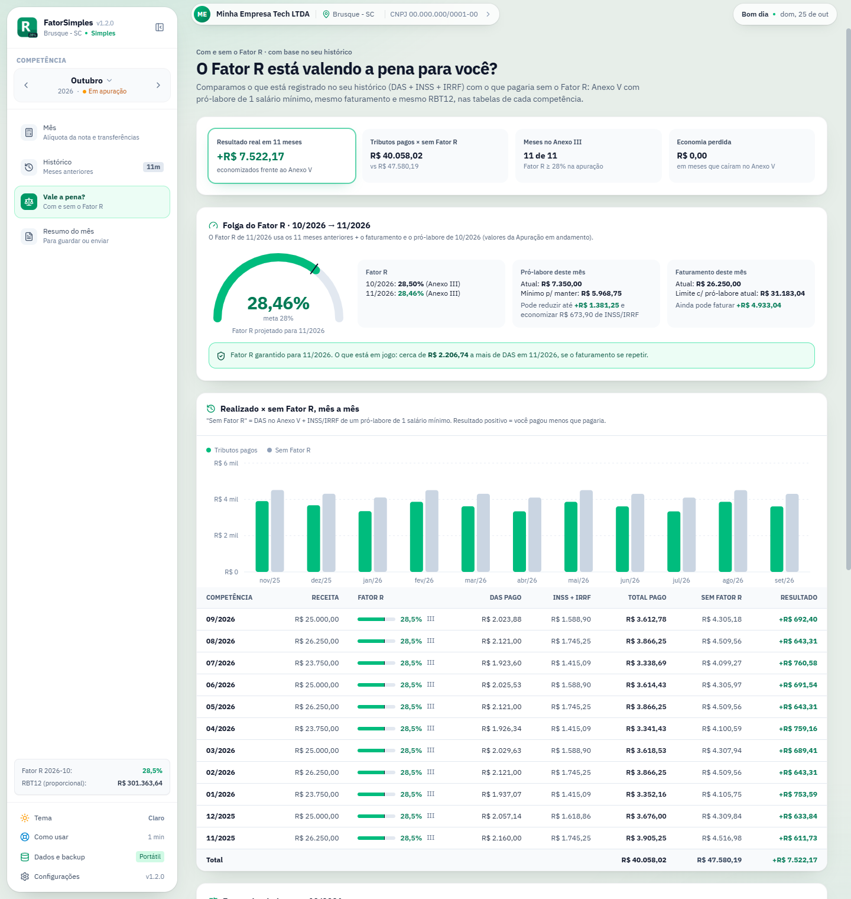
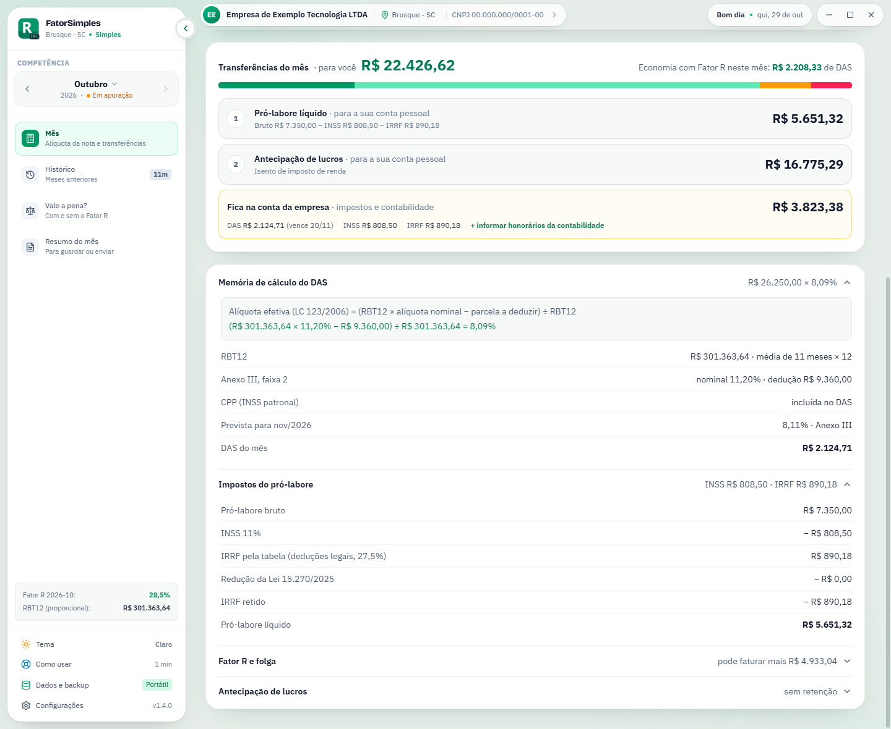
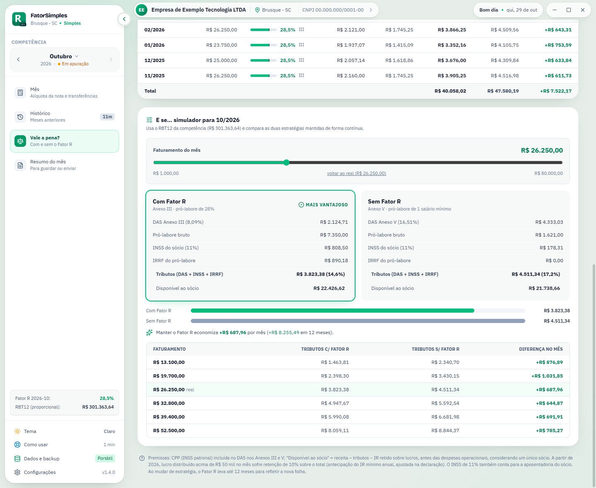
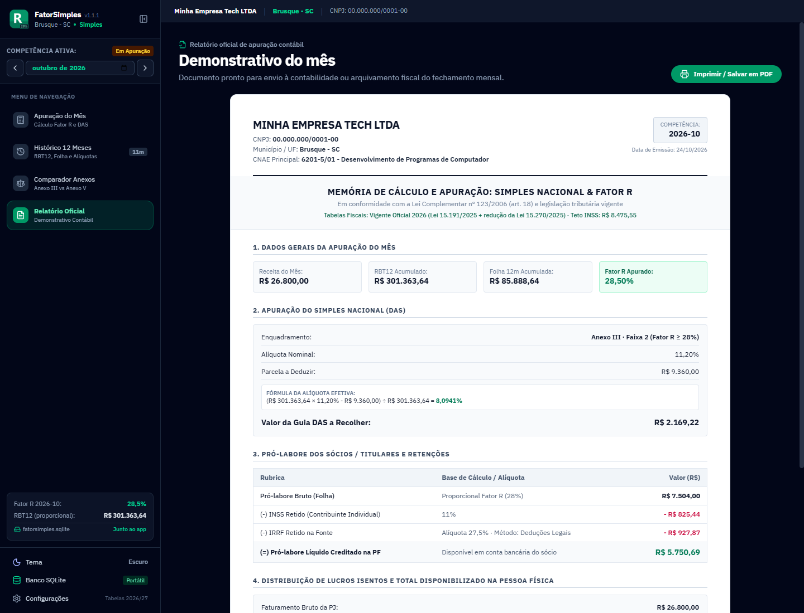
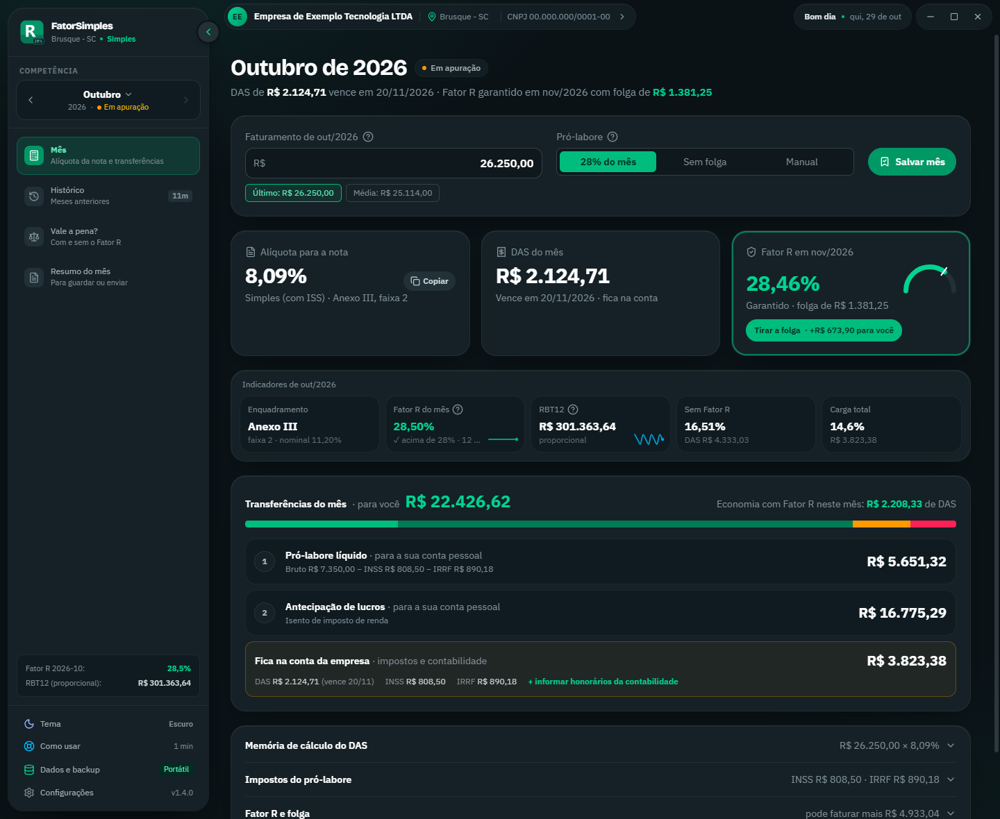
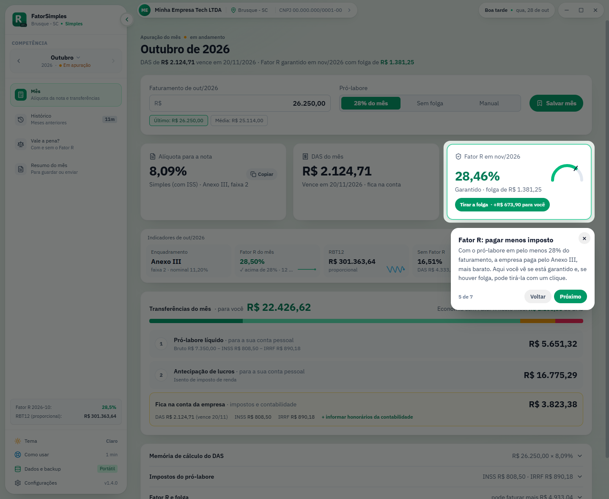

<div align="center">



<br />

**Apuração mensal do Simples Nacional e do Fator R para quem presta serviço.**<br />
A alíquota para a nota, quanto transferir para você e quanto deixar na conta da empresa, sem precisar perguntar à contabilidade.

<br />

[](https://github.com/leandrotsampa/FatorSimples/releases/latest)
[](https://github.com/leandrotsampa/FatorSimples/releases)
[](https://github.com/leandrotsampa/FatorSimples)
[](LICENSE)
<br />


[**Baixar para Windows, macOS ou Linux**](https://github.com/leandrotsampa/FatorSimples/releases/latest) ·
[Funcionalidades](#-funcionalidades) ·
[Telas](#-telas) ·
[Como o cálculo funciona](#-como-o-cálculo-funciona) ·
[Desenvolvimento](#-desenvolvimento)

</div>

---

## 💡 Por que existe

Empresas do Simples Nacional que prestam serviços sujeitos ao **Fator R** (desenvolvimento de software, consultoria, engenharia, saúde e outras) pagam o DAS pelo **Anexo III**, a partir de 6%, quando a folha de salários dos últimos 12 meses chega a **28% da receita**. Abaixo disso, vão para o **Anexo V**, a partir de 15,5%.

Na prática, isso vira uma conta que precisa ser feita todo mês: qual alíquota informar na nota fiscal, quanto de pró-labore retirar para manter os 28%, quanto isso custa de INSS e IRRF e quanto pode ir para a sua conta. O **FatorSimples** faz essa conta com as regras do PGDAS-D e com o seu histórico real, e mostra o resultado de forma direta, pensado para quem não é contador.

> Validado contra recibos reais do PGDAS-D: com a mesma receita e folha, o app chega ao **mesmo RBT12, Fator R e valor do DAS**, com diferença máxima de R$ 0,01 por arredondamento dos tributos.

## ✨ Funcionalidades

<table>
<tr>
<td width="50%" valign="top">

### 📅 Mês
- **Três respostas no topo:** a **alíquota para a nota** (com botão de copiar), o DAS com vencimento e o Fator R garantido para o mês seguinte
- **Transferências do mês:** pró-labore líquido e antecipação de lucros para a sua conta, e o que fica na conta da empresa (DAS, INSS, IRRF e contabilidade)
- Pró-labore em **28% do mês**, **sem folga** (o mínimo que mantém os 28%) ou **manual**. O botão **Tirar a folga** mostra quanto a mais vai para você
- Honorários da contabilidade na conta e aviso quando o faturamento não cobre pró-labore, DAS e contabilidade
- Indicadores do mês e memória de cálculo completa, recolhida por padrão

</td>
<td width="50%" valign="top">

### ⚖️ Vale a pena?
- **Realizado × sem Fator R** mês a mês, com o que você pagou de fato
- **Folga do Fator R:** quanto ainda dá para faturar ou reduzir de pró-labore sem cair no Anexo V
- Simulador "e se" centrado no seu faturamento real
- Avisa quando o Fator R fica abaixo de 28% **por centavos**

</td>
</tr>
<tr>
<td valign="top">

### 🗂️ Histórico
- Receita, folha, INSS, IRRF e DAS por competência
- Fator R **de apuração** de cada mês (12 meses anteriores), com o anexo
- Importação e exportação em JSON, com cálculo automático de INSS, IRRF e DAS que vierem zerados
- Alerta de divergência entre o DAS pago e o calculado

</td>
<td valign="top">

### 🧾 Tabelas e regras atualizadas
- Tabelas oficiais por competência: salário mínimo, teto do INSS e IRRF (2024 a 2027)
- **Atualização pelo GitHub:** o app já vem com as tabelas e confere se há tabelas novas (no máximo uma vez por dia). Também avisa quando sai uma versão nova do app
- **Lei 15.270/2025:** redução do IRRF até R$ 7.350 e retenção de 10% sobre lucros acima de R$ 50 mil/mês
- Regras da Resolução CGSN 140/2018 para folha ou receita zeradas
- **Resumo do mês** pronto para imprimir, salvar em PDF ou mandar para a contabilidade

</td>
</tr>
<tr>
<td valign="top">

### 🎓 Fácil de começar
- **Tutorial guiado** na primeira abertura, em 1 minuto, com a opção de explorar sozinho
- Cada tela se apresenta na primeira visita, e o botão **Como usar** mostra o passo a passo da tela atual
- Depois de atualizar o app, só as **novidades** aparecem, uma vez

</td>
<td valign="top">

### 🎨 Interface
- Tema **claro** por padrão e **escuro** a um clique, com a troca animada a partir do botão
- Menu lateral recolhível, que lembra a sua escolha
- Animações suaves e sons sutis (ligados por padrão), que podem ser desligados nas Configurações
- Barra de título própria, com os dados da empresa a um clique

</td>
</tr>
</table>

**Privado por padrão:** os dados ficam num arquivo SQLite no seu computador. Nada é enviado para a internet.

## 📸 Telas

<div align="center">


<sub><b>Mês:</b> a alíquota para a nota, o DAS, o Fator R do mês seguinte e as transferências do mês</sub>

<br /><br />


<sub><b>Vale a pena?:</b> economia real com o Fator R, folga do mês e o realizado mês a mês</sub>

</div>

<details>
<summary><b>Ver mais telas</b></summary>
<br />

| Transferências e memória de cálculo | Simulador "e se" |
|:---:|:---:|
|  |  |
| **Histórico** | **Resumo do mês** |
|  |  |
| **Tema escuro** | **Tutorial guiado** |
|  |  |

</details>

> As telas usam dados de exemplo gerados pelo próprio app.

## 🧮 Como o cálculo funciona

<details open>
<summary><b>Fator R, RBT12 e alíquota efetiva</b></summary>
<br />

| Conceito | Regra |
|---|---|
| **RBT12** | Receita bruta dos 12 meses **anteriores** à competência. Com menos de 12 meses de atividade, média dos meses × 12 (LC 123, art. 18, § 2º) |
| **Fator R** | Folha dos 12 meses anteriores ÷ RBT12. **≥ 28% → Anexo III**; abaixo → Anexo V |
| **Folha ou receita zerada** | Folha > 0 e receita = 0 → Fator R = 0,28; folha = 0 e receita > 0 → 0,01 (Resolução CGSN 140/2018) |
| **Alíquota efetiva** | `(RBT12 × alíquota nominal − parcela a deduzir) ÷ RBT12` |
| **DAS** | Receita do mês × alíquota efetiva. A CPP (INSS patronal) já está incluída nos Anexos III e V |

O pró-labore do mês entra no Fator R das **próximas** competências, não no DAS do mês. Por isso a tela mostra o Fator R do mês seguinte e a folga para mantê-lo. O valor de 28% é sempre arredondado **para cima** no centavo, para nunca ficar abaixo do limite por arredondamento.

</details>

<details>
<summary><b>Pró-labore: INSS e IRRF</b></summary>
<br />

- **INSS:** 11% do pró-labore, limitado ao teto da competência
- **IRRF:** tabela progressiva mensal, escolhendo o menor entre deduções legais e desconto simplificado
- **Redução da Lei 15.270/2025 (a partir de 2026):** pró-labore bruto até R$ 5.000 fica isento; até R$ 7.350, a redução é `R$ 978,62 − 0,133145 × rendimento`; acima disso, não há redução
- Cada competência usa a tabela do seu ano. Em 2025, a tabela muda a partir de maio (Lei 15.191/2025)

</details>

<details>
<summary><b>Comparação com e sem Fator R</b></summary>
<br />

| | Com Fator R | Sem Fator R |
|---|---|---|
| Pró-labore | 28% da receita | 1 salário mínimo |
| Anexo | III | V |
| Compara | DAS + INSS + IRRF | DAS + INSS + IRRF |

O pró-labore em si não é custo: é dinheiro que vai para o sócio. Por isso a comparação é feita pelos **impostos** de cada cenário. O "realizado" usa os valores efetivamente pagos que estão no histórico.

</details>

<details>
<summary><b>Transferências do mês e o que fica na conta</b></summary>
<br />

Depois de receber, o faturamento do mês se divide em três partes, que somam exatamente o valor recebido:

| Parte | Conta |
|---|---|
| **Pró-labore líquido** (para você) | Pró-labore bruto − INSS − IRRF |
| **Antecipação de lucros** (para você) | Faturamento − DAS − pró-labore bruto − contabilidade − IR retido sobre lucros |
| **Fica na conta da empresa** | DAS + INSS + IRRF + IR retido sobre lucros + contabilidade |

Se o faturamento não cobre o pró-labore, o DAS e a contabilidade, a tela avisa quanto falta na conta.

</details>

<details>
<summary><b>Lucros distribuídos (2026+)</b></summary>
<br />

O lucro que sobra na empresa após DAS e pró-labore pode ser distribuído ao sócio. A partir de 2026, distribuições acima de **R$ 50.000 no mês** pela mesma empresa à mesma pessoa física têm retenção de **10% sobre o valor total** (Lei 15.270/2025). O valor retido é antecipação do IR mínimo anual e é ajustado na declaração.

</details>

## 📥 Instalação

Baixe o arquivo do seu sistema em [**Releases**](https://github.com/leandrotsampa/FatorSimples/releases/latest):

| Sistema | Arquivo | Onde fica o banco `fatorsimples.sqlite` |
|---|---|---|
| 🪟 **Windows** (instalador, recomendado) | `FatorSimples-x.y.z-setup.exe` | `%APPDATA%\FatorSimples` |
| 🪟 **Windows** (portátil) | `FatorSimples-x.y.z-portable.exe` | Na mesma pasta do `.exe` |
| 🍎 **macOS** (chip Apple) | `FatorSimples-x.y.z-mac-arm64.dmg` | `~/Library/Application Support/FatorSimples` |
| 🍎 **macOS** (Intel) | `FatorSimples-x.y.z-mac-x64.dmg` | `~/Library/Application Support/FatorSimples` |
| 🐧 **Linux** | `FatorSimples-x.y.z-linux-x64.AppImage` | Na mesma pasta do `.AppImage` |

<details>
<summary><b>🪟 Windows</b></summary>
<br />

**Instalador (recomendado).** Abre em cerca de 1 segundo, porque não precisa descompactar o app a cada abertura.

1. Abra o `FatorSimples-x.y.z-setup.exe`. Ele instala só para o seu usuário, sem pedir permissão de administrador, e cria atalhos na área de trabalho e no menu Iniciar
2. Para atualizar, rode o instalador da versão nova. Ele instala por cima, fecha o app se estiver aberto e mantém os seus dados
3. Os dados ficam em `%APPDATA%\FatorSimples` e continuam lá mesmo se você desinstalar o app

**Portátil.** Não instala nada, mas demora mais para abrir, porque descompacta o app a cada abertura.

1. Coloque o `.exe` numa pasta sua, por exemplo `Documentos\FatorSimples`, e abra
2. Para atualizar, troque só o `.exe` e mantenha o `fatorsimples.sqlite` ao lado

**Do portátil para o instalador.** Com o app fechado, copie o `fatorsimples.sqlite` da pasta do portátil para `%APPDATA%\FatorSimples` (cole o endereço na barra do Explorador de Arquivos). Outra forma é usar **Dados e backup → Exportar Dados** no portátil e **Importar Dados** no instalado.

O SmartScreen pode avisar na primeira execução, porque o executável não tem assinatura de código comercial. Clique em **Mais informações → Executar assim mesmo**.

</details>

<details>
<summary><b>🍎 macOS</b></summary>
<br />

1. Abra o `.dmg` e arraste o **FatorSimples** para **Aplicativos**
2. Na primeira abertura, o macOS bloqueia porque o app não é assinado pela Apple. Vá em **Ajustes do Sistema → Privacidade e Segurança** e clique em **Abrir Mesmo Assim**
3. Se aparecer a mensagem de que o app "está danificado", rode no Terminal:

```bash
xattr -cr /Applications/FatorSimples.app
```

Os dados ficam fora do app, então atualizar substituindo o FatorSimples em Aplicativos não apaga nada.

</details>

<details>
<summary><b>🐧 Linux</b></summary>
<br />

1. Dê permissão de execução e abra:

```bash
chmod +x FatorSimples-*.AppImage
```

2. Para atualizar, troque só o `.AppImage` e mantenha o `fatorsimples.sqlite` ao lado

</details>

Para fazer backup, copie o `fatorsimples.sqlite`. O menu **Dados e backup** do app mostra onde ele está e abre a pasta.

## 🔄 Importando o seu histórico

Pelo menu **Dados e backup → Importar Dados**, o app aceita um JSON no formato abaixo. As competências são mescladas por mês, e o resumo mostra o que será incluído ou substituído antes de gravar. INSS, IRRF e DAS zerados são calculados na importação.

```json
{
  "app": "FatorSimples",
  "formato": "dados-competencias",
  "versao": 1,
  "competencias": [
    { "yearMonth": "2026-09", "revenue": 18928.64, "payroll": 5302.00, "inss": 583.22, "irrf": 109.65, "dasPaid": 1393.80 }
  ]
}
```

**De onde tirar os números oficiais:**
- **Receita e folha:** recibo do PGDAS-D. Cada recibo traz as receitas desde janeiro do ano anterior e as folhas dos 12 meses anteriores
- **DAS, INSS e IRRF pagos:** e-CAC → *Pagamentos e Parcelamentos → Consulta Comprovante de Pagamento*. Na lista, cada guia aparece com o código da receita:

  | Código | Guia | Campo no app |
  |---|---|---|
  | **3333** | DAS do Simples Nacional | DAS pago |
  | **1410** | DARF da DCTFWeb, com **INSS e IRRF juntos** | INSS + IRRF |

  Para separar a guia 1410, o INSS é 11% do pró-labore (limitado ao teto) e o restante é IRRF. A data da guia é a do pagamento: a competência é sempre o mês anterior

## 🛠️ Desenvolvimento

**Requisitos:** Node.js 22+. Cada instalável é gerado no próprio sistema (o `.exe` no Windows, o `.dmg` no macOS e o `.AppImage` no Linux); a action de release faz os três de uma vez.

```bash
npm install
```

```bash
npm run dev
```

| Script | O que faz |
|---|---|
| `npm run dev` | Interface no navegador em `http://localhost:3000`, com dados no `localStorage` |
| `npm run electron:dev` | Abre o app desktop (usa o build em `dist/` se existir; senão, o servidor em `:3000`) |
| `npm run lint` | Checagem de tipos com TypeScript |
| `npm test` | Testes automatizados (Vitest) dos cálculos, das tabelas e da interface |
| `npm run build` | Build de produção da interface em `dist/` |
| `npm run dist:win` | Gera o instalador `release/FatorSimples-<versão>-setup.exe` e o portátil (Windows) |
| `npm run dist:portable` | Gera só o portátil `release/FatorSimples-<versão>-portable.exe` (Windows) |
| `npm run dist:mac` | Gera os `.dmg` para Mac com chip Apple e Intel (macOS) |
| `npm run dist:linux` | Gera o `.AppImage` (Linux) |

### Publicando uma versão

As releases são geradas pela action **[Gerar release](.github/workflows/release.yml)**, disparada manualmente:

1. Ajuste o campo `version` do `package.json` (por exemplo, `1.1.1` → `1.2.0`) e faça o commit na `main`
2. No GitHub, abra **Actions → Gerar release → Run workflow**. Dá para marcar como pré-lançamento ou rascunho
3. A action compila em paralelo no **Windows**, no **macOS** e no **Linux**, gera o changelog a partir dos commits desde a última versão, atualiza o [`CHANGELOG.md`](CHANGELOG.md) e publica a release com o instalador e o portátil do Windows, os `.dmg`, o `.AppImage` e os checksums SHA-256

O changelog agrupa os commits pelo prefixo: `feat:` (novidades), `fix:` (correções), `docs:`, `refactor:`, `perf:`, `build:` e `chore:`. A versão exibida no app também vem do `package.json`.

### Estrutura

```
fatorsimples/
├── electron/              # processo principal: janela, SQLite local e ponte segura (preload)
├── src/
│   ├── components/        # telas: Mês, Histórico, Vale a pena?, Resumo do mês e modais
│   ├── tour/              # tutorial guiado (driver.js): passos por tela e o que já foi visto
│   ├── hooks/             # preferências da interface, sons e contagem animada
│   ├── utils/
│   │   ├── taxCalculations.ts    # Fator R, RBT12, DAS, INSS, IRRF, folga, transferências e comparativos
│   │   ├── taxTablesRegistry.ts  # tabelas oficiais por competência
│   │   ├── remoteTables.ts       # atualização das tabelas pelo GitHub e aviso de versão nova
│   │   ├── dataTransfer.ts       # importação e exportação em JSON
│   │   └── storageAdapter.ts     # SQLite (desktop) ou localStorage (navegador)
│   └── types/             # tipos do domínio fiscal
├── tax-tables/            # tabelas.json publicado para os apps já instalados
├── scripts/               # empacotamento, notas de release e exportação das tabelas
├── build/                 # ícones do app (Windows, macOS e Linux)
└── docs/                  # banner e capturas do README
```

### Tabelas fiscais

As tabelas ficam em [`src/utils/taxTablesRegistry.ts`](src/utils/taxTablesRegistry.ts), uma por vigência (`validFrom` e `validTo`), com salário mínimo, teto do INSS, faixas do IRRF, desconto simplificado e as regras da Lei 15.270/2025. A competência escolhe a tabela automaticamente. A tabela de 2027 repete os valores de 2026 até a publicação oficial.

O app já nasce com essas tabelas. Os apps instalados recebem alterações pelo arquivo [`tax-tables/tabelas.json`](tax-tables/tabelas.json) da `main`, validado antes de entrar no banco local e aplicado só se for mais novo que as tabelas embutidas. Quando sair uma tabela nova:

1. Adicione ou ajuste a versão em `taxTablesRegistry.ts` e atualize `BUILTIN_TABLES_DATE`
2. Gere o arquivo publicado:

```bash
npx tsx scripts/export-tax-tables.ts
```

3. Faça o commit e o push na `main`. Os apps instalados aplicam as tabelas na próxima verificação

## 🗺️ Próximos passos

- [ ] Importar recibos do PGDAS-D e a lista de pagamentos do e-CAC direto em PDF
- [ ] Indicar quando a linha do histórico não tem os 12 meses anteriores disponíveis
- [ ] Suporte a mais de um sócio na distribuição de lucros
- [x] Testes automatizados dos cálculos com casos reais

## ⚠️ Aviso

O FatorSimples é uma ferramenta de apoio ao planejamento e à conferência. Ele **não substitui** a apuração oficial no PGDAS-D nem a orientação de um contador. As regras e tabelas foram implementadas com cuidado e validadas contra recibos reais, mas a legislação muda: confira sempre os valores antes de pagar.

## 📊 Acompanhamento

<div align="center">

[](https://github.com/leandrotsampa/FatorSimples)
[](https://github.com/leandrotsampa/FatorSimples/releases)
[](https://github.com/leandrotsampa/FatorSimples/stargazers)
[](https://github.com/leandrotsampa/FatorSimples/commits)

<sub>O contador de visualizações soma cada abertura desta página. Visitantes únicos e clones ficam em <b>Insights → Traffic</b> no GitHub.</sub>

<br /><br />

<a href="https://www.star-history.com/?repos=leandrotsampa%2FFatorSimples&type=date&legend=top-left">
  <picture>
    <source media="(prefers-color-scheme: dark)" srcset="https://api.star-history.com/chart?repos=leandrotsampa%2Ffatorsimples&type=date&theme=dark&legend=top-left" />
    <source media="(prefers-color-scheme: light)" srcset="https://api.star-history.com/chart?repos=leandrotsampa%2Ffatorsimples&type=date&legend=top-left" />
    
  </picture>
</a>

<sub>Crescimento do projeto na comunidade (estrelas ao longo do tempo).</sub>

</div>

## 📄 Licença

Distribuído sob a licença [MIT](LICENSE). © 2026 Leandro Tavares de Melo.

<div align="center">
<sub>Feito para quem prefere entender o próprio imposto.</sub>
</div>
