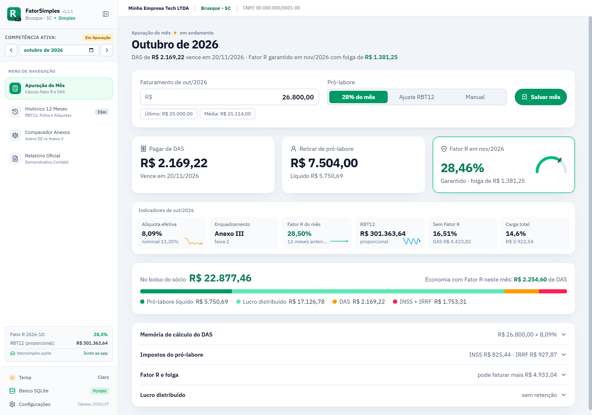

<div align="center">


<br />

**Apuração mensal do Simples Nacional e do Fator R para quem presta serviço.**<br />
Quanto pagar de DAS, quanto retirar de pró-labore e quanto o Anexo III economiza de verdade.

<br />

[](https://github.com/leandrotsampa/fatorsimples/releases/latest)
[](https://github.com/leandrotsampa/fatorsimples/releases)
[](https://github.com/leandrotsampa/fatorsimples)
[](LICENSE)
<br />


[**Baixar para Windows**](https://github.com/leandrotsampa/fatorsimples/releases/latest) ·
[Funcionalidades](#-funcionalidades) ·
[Telas](#-telas) ·
[Como o cálculo funciona](#-como-o-cálculo-funciona) ·
[Desenvolvimento](#-desenvolvimento)

</div>

---

## 💡 Por que existe

Empresas do Simples Nacional que prestam serviços sujeitos ao **Fator R** (desenvolvimento de software, consultoria, engenharia, saúde e outras) pagam o DAS pelo **Anexo III**, a partir de 6%, quando a folha de salários dos últimos 12 meses chega a **28% da receita**. Abaixo disso, vão para o **Anexo V**, a partir de 15,5%.

Na prática, isso vira uma conta que precisa ser feita todo mês: quanto de pró-labore retirar para manter os 28%, quanto isso custa de INSS e IRRF e se a troca compensa. O **FatorSimples** faz essa conta com as regras do PGDAS-D e com o seu histórico real, e mostra o resultado de forma direta.

> Validado contra recibos reais do PGDAS-D: com a mesma receita e folha, o app chega ao **mesmo RBT12, Fator R e valor do DAS**, com diferença máxima de R$ 0,01 por arredondamento dos tributos.

## ✨ Funcionalidades

<table>
<tr>
<td width="50%" valign="top">

### 📅 Apuração do mês
- **Três respostas no topo:** DAS a pagar (com vencimento), pró-labore a retirar e o Fator R garantido para o mês seguinte
- Indicadores sempre visíveis: alíquota efetiva e nominal, anexo e faixa, RBT12, alíquota sem Fator R e carga total
- Estratégias de pró-labore: **28% do mês**, **ajuste exato pelo RBT12** ou **manual**
- Memória de cálculo completa, recolhida por padrão

</td>
<td width="50%" valign="top">

### ⚖️ Comparador de anexos
- **Realizado × sem Fator R** mês a mês, com o que você pagou de fato
- **Folga do Fator R:** quanto ainda dá para faturar ou reduzir de pró-labore sem cair no Anexo V
- Simulador "e se" centrado no seu faturamento real
- Avisa quando o Fator R fica abaixo de 28% **por centavos**

</td>
</tr>
<tr>
<td valign="top">

### 🗂️ Histórico de 12 meses
- Receita, folha, INSS, IRRF e DAS por competência
- Fator R **de apuração** de cada mês (12 meses anteriores), com o anexo
- Importação e exportação em JSON, com cálculo automático de INSS, IRRF e DAS que vierem zerados
- Alerta de divergência entre o DAS pago e o calculado

</td>
<td valign="top">

### 🧾 Tabelas e regras atualizadas
- Tabelas oficiais por competência: salário mínimo, teto do INSS e IRRF (2024 a 2027)
- **Lei 15.270/2025:** redução do IRRF até R$ 7.350 e retenção de 10% sobre lucros acima de R$ 50 mil/mês
- Regras da Resolução CGSN 140/2018 para folha ou receita zeradas
- Relatório de apuração pronto para imprimir ou salvar em PDF

</td>
</tr>
</table>

**Privado por padrão:** os dados ficam num arquivo SQLite ao lado do executável. Nada é enviado para a internet.

## 📸 Telas

<div align="center">


<sub><b>Apuração do mês:</b> DAS, pró-labore e Fator R do mês seguinte, com os indicadores logo abaixo</sub>

<br /><br />


<sub><b>Comparador de anexos:</b> economia real com o Fator R, folga do mês e o realizado mês a mês</sub>

</div>

<details>
<summary><b>Ver mais telas</b></summary>
<br />

| Memória de cálculo | Simulador "e se" |
|:---:|:---:|
|  |  |
| **Histórico de 12 meses** | **Relatório de apuração** |
|  |  |
| **Tema claro** | |
|  | |

</details>

> As telas usam dados de exemplo gerados pelo próprio app.

## 🧮 Como o cálculo funciona

<details open>
<summary><b>Fator R, RBT12 e alíquota efetiva</b></summary>
<br />

| Conceito | Regra |
|---|---|
| **RBT12** | Receita bruta dos 12 meses **anteriores** à competência. Com menos de 12 meses de atividade, média dos meses × 12 (LC 123, art. 18, § 2º) |
| **Fator R** | Folha dos 12 meses anteriores ÷ RBT12. **≥ 28% → Anexo III**; abaixo → Anexo V |
| **Folha ou receita zerada** | Folha > 0 e receita = 0 → Fator R = 0,28; folha = 0 e receita > 0 → 0,01 (Resolução CGSN 140/2018) |
| **Alíquota efetiva** | `(RBT12 × alíquota nominal − parcela a deduzir) ÷ RBT12` |
| **DAS** | Receita do mês × alíquota efetiva. A CPP (INSS patronal) já está incluída nos Anexos III e V |

O pró-labore do mês entra no Fator R das **próximas** competências, não no DAS do mês. Por isso a tela mostra o Fator R do mês seguinte e a folga para mantê-lo. O valor de 28% é sempre arredondado **para cima** no centavo, para nunca ficar abaixo do limite por arredondamento.

</details>

<details>
<summary><b>Pró-labore: INSS e IRRF</b></summary>
<br />

- **INSS:** 11% do pró-labore, limitado ao teto da competência
- **IRRF:** tabela progressiva mensal, escolhendo o menor entre deduções legais e desconto simplificado
- **Redução da Lei 15.270/2025 (a partir de 2026):** pró-labore bruto até R$ 5.000 fica isento; até R$ 7.350, a redução é `R$ 978,62 − 0,133145 × rendimento`; acima disso, não há redução
- Cada competência usa a tabela do seu ano. Em 2025, a tabela muda a partir de maio (Lei 15.191/2025)

</details>

<details>
<summary><b>Comparação com e sem Fator R</b></summary>
<br />

| | Com Fator R | Sem Fator R |
|---|---|---|
| Pró-labore | 28% da receita | 1 salário mínimo |
| Anexo | III | V |
| Compara | DAS + INSS + IRRF | DAS + INSS + IRRF |

O pró-labore em si não é custo: é dinheiro que vai para o sócio. Por isso a comparação é feita pelos **impostos** de cada cenário. O "realizado" usa os valores efetivamente pagos que estão no histórico.

</details>

<details>
<summary><b>Lucros distribuídos (2026+)</b></summary>
<br />

O lucro que sobra na empresa após DAS e pró-labore pode ser distribuído ao sócio. A partir de 2026, distribuições acima de **R$ 50.000 no mês** pela mesma empresa à mesma pessoa física têm retenção de **10% sobre o valor total** (Lei 15.270/2025). O valor retido é antecipação do IR mínimo anual e é ajustado na declaração.

</details>

## 📥 Instalação

1. Baixe o `FatorSimples-x.y.z-portable.exe` em [**Releases**](https://github.com/leandrotsampa/fatorsimples/releases/latest)
2. Coloque o arquivo numa pasta sua, por exemplo `Documentos\FatorSimples`
3. Abra. Não precisa instalar nada

O banco `fatorsimples.sqlite` é criado **na mesma pasta do executável**. Para atualizar, troque só o `.exe` e mantenha o `.sqlite` ao lado. Para fazer backup, copie esse arquivo.

> O Windows SmartScreen pode avisar na primeira execução, porque o executável não tem assinatura de código comercial. Clique em **Mais informações → Executar assim mesmo**.

## 🔄 Importando o seu histórico

Pelo menu **Banco SQLite → Importar dados**, o app aceita um JSON no formato abaixo. As competências são mescladas por mês, e o resumo mostra o que será incluído ou substituído antes de gravar. INSS, IRRF e DAS zerados são calculados na importação.

```json
{
  "app": "FatorSimples",
  "formato": "dados-competencias",
  "versao": 1,
  "competencias": [
    { "yearMonth": "2026-09", "revenue": 18928.64, "payroll": 5302.00, "inss": 583.22, "irrf": 109.65, "dasPaid": 1393.80 }
  ]
}
```

**De onde tirar os números oficiais:**
- **Receita e folha:** recibo do PGDAS-D. Cada recibo traz as receitas desde janeiro do ano anterior e as folhas dos 12 meses anteriores
- **DAS, INSS e IRRF pagos:** e-CAC → *Pagamentos e Parcelamentos → Consulta Comprovante de Pagamento*. Código **3333** é o DAS; o DARF da DCTFWeb traz INSS e IRRF juntos

## 🛠️ Desenvolvimento

**Requisitos:** Node.js 22+ e Windows (para gerar o executável).

```bash
npm install
```

```bash
npm run dev
```

| Script | O que faz |
|---|---|
| `npm run dev` | Interface no navegador em `http://localhost:3000`, com dados no `localStorage` |
| `npm run electron:dev` | Abre o app desktop (usa o build em `dist/` se existir; senão, o servidor em `:3000`) |
| `npm run lint` | Checagem de tipos com TypeScript |
| `npm run build` | Build de produção da interface em `dist/` |
| `npm run dist:portable` | Gera `release/FatorSimples-<versão>-portable.exe` |

A versão exibida no app vem do `package.json`. Para lançar uma versão nova, ajuste o campo `version` e rode `npm run dist:portable`.

### Estrutura

```
fatorsimples/
├── electron/              # processo principal: janela, SQLite local e ponte segura (preload)
├── src/
│   ├── components/        # telas: Apuração, Histórico, Comparador, Relatório e modais
│   ├── utils/
│   │   ├── taxCalculations.ts    # Fator R, RBT12, DAS, INSS, IRRF, folga e comparativos
│   │   ├── taxTablesRegistry.ts  # tabelas oficiais por competência
│   │   ├── dataTransfer.ts       # importação e exportação em JSON
│   │   └── storageAdapter.ts     # SQLite (desktop) ou localStorage (navegador)
│   └── types/             # tipos do domínio fiscal
├── scripts/               # preparação do Electron para o empacotamento
├── build/                 # ícone do executável
└── docs/                  # banner e capturas do README
```

### Tabelas fiscais

As tabelas ficam em [`src/utils/taxTablesRegistry.ts`](src/utils/taxTablesRegistry.ts), uma por vigência, com salário mínimo, teto do INSS, faixas do IRRF, desconto simplificado e as regras da Lei 15.270/2025. A competência escolhe a tabela automaticamente. Quando sair uma tabela nova, basta adicionar a versão e apontá-la em `getTaxTableForCompetence`. A tabela de 2027 repete os valores de 2026 até a publicação oficial.

## 🗺️ Próximos passos

- [ ] Importar recibos do PGDAS-D e a lista de pagamentos do e-CAC direto em PDF
- [ ] Indicar quando a linha do histórico não tem os 12 meses anteriores disponíveis
- [ ] Suporte a mais de um sócio na distribuição de lucros
- [ ] Testes automatizados dos cálculos com casos reais

## ⚠️ Aviso

O FatorSimples é uma ferramenta de apoio ao planejamento e à conferência. Ele **não substitui** a apuração oficial no PGDAS-D nem a orientação de um contador. As regras e tabelas foram implementadas com cuidado e validadas contra recibos reais, mas a legislação muda: confira sempre os valores antes de pagar.

## 📊 Acompanhamento

<div align="center">

[](https://github.com/leandrotsampa/fatorsimples)
[](https://github.com/leandrotsampa/fatorsimples/releases)
[](https://github.com/leandrotsampa/fatorsimples/stargazers)
[](https://github.com/leandrotsampa/fatorsimples/commits)

<sub>O contador de visualizações soma cada abertura desta página. Visitantes únicos e clones ficam em <b>Insights → Traffic</b> no GitHub.</sub>

<br /><br />

<a href="https://star-history.com/#leandrotsampa/fatorsimples&Date">
  <picture>
    <source media="(prefers-color-scheme: dark)" srcset="https://api.star-history.com/svg?repos=leandrotsampa/fatorsimples&type=Date&theme=dark" />
    <source media="(prefers-color-scheme: light)" srcset="https://api.star-history.com/svg?repos=leandrotsampa/fatorsimples&type=Date" />
    
  </picture>
</a>

<sub>Crescimento do projeto na comunidade (estrelas ao longo do tempo).</sub>

</div>

## 📄 Licença

Distribuído sob a licença [MIT](LICENSE). © 2026 Leandro Tavares de Melo.

<div align="center">
<sub>Feito para quem prefere entender o próprio imposto.</sub>
</div>
